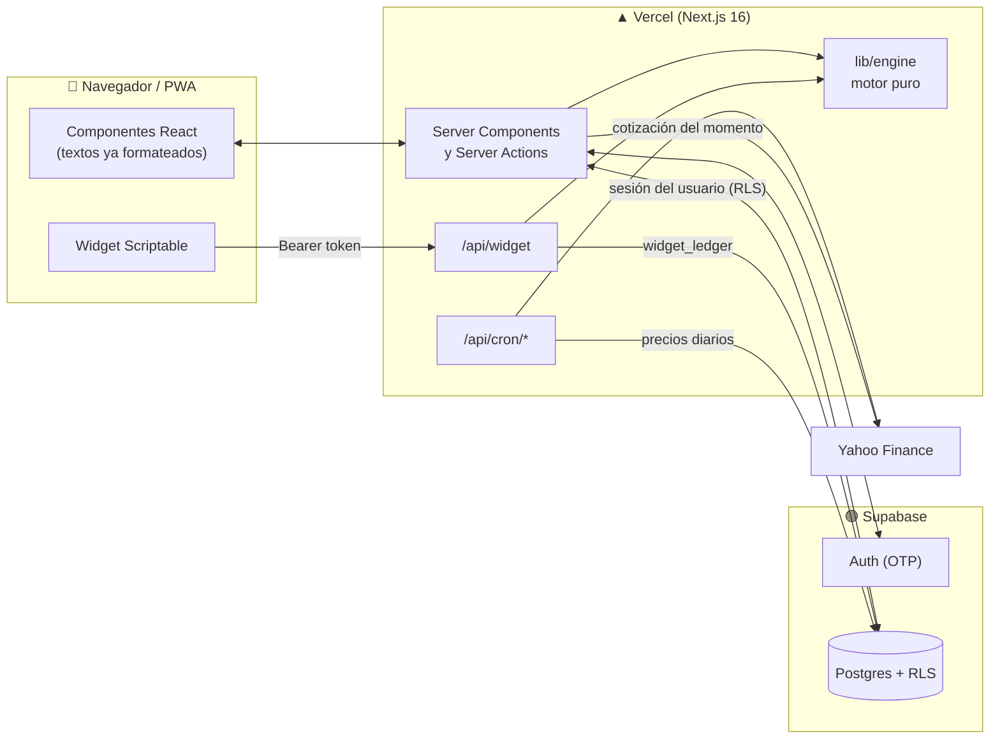

<div align="center">


# Portfolio Tracker

**Seguimiento personal de inversiones: acciones, ETFs y cripto, con métricas serias y costo de operación cero.**

Instalable en el iPhone como app, con widget en la pantalla de inicio.

[](https://nextjs.org)
[](https://react.dev)
[](https://www.typescriptlang.org)
[](https://supabase.com)
[](https://tailwindcss.com)
[](#tests)
[](#pwa-y-widget)
[](LICENSE)

</div>

---

## Contenido

- [Qué hace](#qué-hace)
- [Cómo está hecho](#cómo-está-hecho)
- [Stack](#stack)
- [Estructura del repo](#estructura-del-repo)
- [Empezar](#empezar)
- [Comandos](#comandos)
- [Tests](#tests)
- [Despliegue](#despliegue)
- [Seguridad y privacidad](#seguridad-y-privacidad)
- [Documentación](#documentación)
- [Estado](#estado)
- [Licencia](#licencia)

## Qué hace

Las **transacciones son la única fuente de verdad**. Posiciones, efectivo, ganancias y rendimientos se derivan de ellas cada vez, con aritmética decimal exacta.

### 📊 Inicio

- **Valor total** (posiciones + efectivo), cambio del día, **ganancia total** sobre lo aportado y aportado neto.
- **Rendimiento:** ganancia acumulada, **TWR** (ponderado por tiempo), **XIRR** (ponderado por dinero) y comparación contra un benchmark (S&P 500 o Bitcoin), en rangos de 1S a «Todo».
- **Ganancia por posición** (abiertas y cerradas), **composición** por activo y por tipo, **rendimiento por mes** y **riesgo** (caída máxima, volatilidad, mejor y peor día).
- **Actualizar precios:** trae la cotización del momento y la suma como último punto de cada serie.

### 💼 Posiciones y ficha de cada activo

- Cantidad, costo promedio (las comisiones van al costo), valor, ganancia no realizada y realizada.
- Ficha por símbolo: **evolución del precio** (1S, 1M, 3M, 1A) con el rango de 52 semanas, **datos de la empresa** y **ganancias contra el consenso**.
- **«Antes de comprar»:** cómo cambiarían el riesgo y la composición de la cartera si sumás ese activo. No es una recomendación de compra, y la tarjeta lo dice.

### 🧾 Actividad e importación

- Alta, edición y baja de compras, ventas, dividendos, depósitos, retiros y splits. Cada cambio pasa por una validación del libro completo antes de guardarse.
- Al elegir el símbolo, el formulario deja escrita la cotización actual.
- **Importar CSV** con detección automática del formato:
  - el **formato simple** propio, con plantilla descargable y el mismo que escribe «Exportar CSV» (sirve de backup);
  - el **export de Delta**.
- Vista previa con lo que se va a cargar, lo ignorado y cómo quedaría la cartera. Detecta operaciones repetidas y permite **deshacer una importación entera**.

### 👀 Watchlist

Símbolos seguidos con su precio y cambio del día, hasta 50 por persona.

### 🗂️ Varios portafolios y cripto

- De 1 a 5 portafolios por persona (por ejemplo, uno de acciones y otro de cripto), con la vista **«Todo junto»** que los suma sin mezclar sus cálculos.
- Cripto como pares `-USD` (`BTC-USD`, `ETH-USD`…).

### 📱 PWA y widget

- **Instalable** en el iPhone, con modo oscuro según el sistema y pantalla sin conexión. El service worker **no guarda datos financieros en caché**.
- **Widget de iPhone** (con [Scriptable](https://scriptable.app)) con el valor y la ganancia del día, protegido por un código personal de solo lectura. Guía: [`docs/widget-iphone.md`](docs/widget-iphone.md).

### 🔐 Acceso por invitación

Se entra con un **código de 6 dígitos por email**, sin contraseñas, y solo pueden registrarse los emails habilitados.

## Cómo está hecho



**Principios:**

- **Motor puro (`lib/engine`).** Sin base, sin red y sin `Date.now()`: recibe transacciones, precios y la fecha de hoy, y devuelve posiciones, efectivo, series y rendimientos. ESLint lo hace cumplir.
- **Dinero con `decimal.js`.** Los `numeric` de Postgres se leen como texto y entran al motor sin pasar por floats.
- **Datos de mercado en la base.** Un cron diario guarda los cierres (al menos 5 años por instrumento). Ninguna visita consulta al proveedor salvo «Actualizar precios», con límite de uso.
- **Todo lo externo es no confiable.** Lo que llega del usuario, de un CSV o de Yahoo se valida con Zod en el borde.
- **El servidor formatea.** Los componentes de cliente reciben textos y números listos (formato es-UY, hora de Montevideo). Así `decimal.js` no viaja al navegador.

## Stack

| Capa             | Tecnología                                                               |
| ---------------- | ------------------------------------------------------------------------ |
| Framework        | Next.js 16 (App Router, Server Components, Server Actions), React 19     |
| Lenguaje         | TypeScript en modo estricto                                              |
| Base y auth      | Supabase: Postgres con Row Level Security y Auth con código OTP          |
| UI               | Tailwind CSS 4, componentes de shadcn/ui sobre Base UI, Recharts, Lucide |
| Cálculo          | decimal.js, date-fns / date-fns-tz                                       |
| Validación       | Zod 4                                                                    |
| Datos de mercado | `yahoo-finance2` (detrás de una interfaz intercambiable)                 |
| CSV              | PapaParse                                                                |
| Tests            | Vitest y fast-check (propiedades)                                        |
| Hosting          | Vercel (plan Hobby) con Vercel Cron                                      |
| CI               | GitHub Actions: lint, typecheck y tests                                  |

## Estructura del repo

```text
app/
  (app)/              Pantallas con sesión: Inicio, Posiciones, Actividad, Watchlist, Más
  (auth)/login/       Ingreso con código
  api/cron/           Jobs de precios (protegidos con CRON_SECRET)
  api/widget/         Endpoint del widget de iPhone
components/
  app/                Componentes de la app
  ui/                 Primitivas de shadcn/ui
lib/
  engine/             Motor de cálculo puro: posiciones, efectivo, series, TWR, XIRR, riesgo…
  importers/          Parsers de CSV (formato simple y Delta)
  portfolio/          Lectura de la base, armado de vistas y formato
  market-data/        Proveedor de precios (validación y saneo de Yahoo)
  market-jobs/        Lógica de los crons de precios
  db/                 Clientes de Supabase, sesión y tipos generados
  widget/             Respuesta y script del widget
  security/           CSP y cabeceras
  validation/         Esquemas Zod de entrada
supabase/
  migrations/         Esquema, RLS y funciones SQL (18 migraciones)
  templates/          Correos de Auth
  config.toml         Configuración de Auth versionada
docs/                 Guías y bitácora de decisiones
public/               Íconos, service worker y pantalla sin conexión
```

## Empezar

**Requisitos:** Node 22 o superior, pnpm 11 y una cuenta gratuita de [Supabase](https://supabase.com). No hace falta Docker: Supabase se usa solo en la nube.

### 1. Instalar

```bash
pnpm install
cp .env.example .env.local
```

### 2. Crear la base

1. Creá un proyecto en Supabase (el de desarrollo de este repo se llama `finance-dev`).
2. Poné su ref en `supabase/projects.json` (clave `dev`). Los scripts `pnpm db:*` y los tests de integración se niegan a operar sobre cualquier otro proyecto.
3. Vinculá el proyecto y aplicá las migraciones:

   ```bash
   pnpm supabase login
   pnpm supabase link --project-ref <tu-ref>
   pnpm db:push
   pnpm db:config-diff   # revisá el diff antes de aplicarlo
   pnpm supabase config push
   ```

4. Para que lleguen los códigos, cargá un SMTP propio en el panel de Supabase (Authentication → SMTP). Nunca va en el repo.
5. Habilitá tu email:

   ```sql
   insert into public.allowed_emails (email) values ('vos@ejemplo.com');
   ```

El detalle (claves, hook de registro, límites del plan gratuito, pausa por inactividad) está en [`docs/supabase-setup.md`](docs/supabase-setup.md).

### 3. Variables de entorno

| Variable                               | Para qué                                                                             |
| -------------------------------------- | ------------------------------------------------------------------------------------ |
| `NEXT_PUBLIC_SUPABASE_URL`             | URL del proyecto de Supabase                                                         |
| `NEXT_PUBLIC_SUPABASE_PUBLISHABLE_KEY` | Clave publicable (`sb_publishable_…`): pública por diseño, los datos los protege RLS |
| `SUPABASE_SECRET_KEY`                  | Clave secreta (`sb_secret_…`): **solo servidor**, salta RLS                          |
| `CRON_SECRET`                          | Protege `/api/cron/*`. Generala con `openssl rand -hex 32` (mínimo 32 caracteres)    |
| `MARKET_DATA_PROVIDER`                 | `yahoo` (el único implementado)                                                      |
| `APP_TIMEZONE`                         | `America/Montevideo`                                                                 |

`.env.local` está en el `.gitignore`. La plantilla comentada es [`.env.example`](.env.example).

### 4. Levantar

```bash
pnpm dev   # http://localhost:3000
```

Para probar con datos, importá [`lib/engine/__fixtures__/delta_export.csv`](lib/engine/__fixtures__/delta_export.csv) desde **Más → Importar operaciones**. Es un export de Delta de ejemplo.

## Comandos

| Comando                 | Qué hace                                                                                          |
| ----------------------- | ------------------------------------------------------------------------------------------------- |
| `pnpm dev`              | Servidor de desarrollo                                                                            |
| `pnpm build`            | Build de producción                                                                               |
| `pnpm test`             | Tests unitarios (motor, importadores, vistas, seguridad)                                          |
| `pnpm test:coverage`    | Los mismos tests, con cobertura                                                                   |
| `pnpm test:integration` | RLS, registro por invitación y funciones SQL contra la base de desarrollo (necesita `.env.local`) |
| `pnpm test:live`        | Cron contra Yahoo real y la app por HTTP con sesión real (a mano; antes, `pnpm build`)            |
| `pnpm lint`             | ESLint, incluidas las reglas que mantienen puro a `lib/engine`                                    |
| `pnpm typecheck`        | `next typegen` + `tsc --noEmit`                                                                   |
| `pnpm format`           | Prettier                                                                                          |
| `pnpm db:push`          | Aplica las migraciones a la base de desarrollo                                                    |
| `pnpm db:types`         | Regenera `lib/db/database.types.ts`                                                               |
| `pnpm db:config-diff`   | Diferencias de Auth entre `supabase/config.toml` y la base (antes de un `config push`)            |

## Tests

| Suite           | Qué cubre                                                                                                                                            | Dónde corre                         |
| --------------- | ---------------------------------------------------------------------------------------------------------------------------------------------------- | ----------------------------------- |
| **Unitarios**   | Motor (costo promedio, efectivo, splits, TWR, XIRR, riesgo), importadores, vistas, formato, CSP, widget. Incluye tests de propiedades con fast-check | Local y CI                          |
| **Aceptación**  | El export de Delta del fixture, importado y calculado, tiene que dar exactamente los números del spec (§8.3)                                         | Local y CI                          |
| **Integración** | Aislamiento entre usuarios (RLS), registro por invitación, importación atómica, límites de uso                                                       | Local, contra la base de desarrollo |
| **En vivo**     | El cron real contra Yahoo real y cada pantalla por HTTP con una sesión real                                                                          | A mano                              |

> El fixture `lib/engine/__fixtures__/delta_export.csv` es un export de Delta con sus casos borde: filas, patas de efectivo automáticas, comisiones faltantes y un efectivo negativo transitorio.

## Despliegue

- **Vercel** (plan Hobby), funciones en Dublín (`vercel.json`), cerca de la base.
- **Cron:** `/api/cron/daily-prices` corre de lunes a viernes a las 22:00 UTC, con `Authorization: Bearer ${CRON_SECRET}`.
- Variables de Production: las cuatro de Supabase y el cron. Las `NEXT_PUBLIC_*` se incorporan al compilar, así que hay que cargarlas antes del deploy.
- **`.vercelignore`** deja afuera fixtures, docs, tests y `supabase/`. La CLI de Vercel no respeta todo el `.gitignore`: revisá qué sube antes de correr `vercel`.

## Seguridad y privacidad

- **Row Level Security** en todas las tablas de usuario, con los privilegios por defecto revocados. Cada migración que crea una tabla declara sus `GRANT` y su RLS.
- **Sin contraseñas:** se entra solo con el código del correo, con 5 intentos por 15 minutos por email. Un trigger borra cualquier hash de contraseña que Auth llegue a escribir.
- **Sesión en cookies `HttpOnly`** (y `Secure` con HTTPS). No hay cliente de Supabase en el navegador.
- **La clave secreta nunca llega al cliente.** Se usa solo en crons, en el alta de instrumentos y en el widget, siempre a través de una función SQL que fija de quién son los datos.
- **CSP** (`connect-src 'self'`) y cabeceras de seguridad en producción.
- **Crons** con comparación del secreto en tiempo constante. Si el secreto falta o es corto, fallan cerrados.
- **Widget:** el código personal se guarda solo como SHA-256 y viaja en el header, nunca en la URL.

Los riesgos residuales aceptados están en [`docs/decisions.md`](docs/decisions.md), en «Revisión de seguridad».

## Documentación

| Documento                                                    | Contenido                                              |
| ------------------------------------------------------------ | ------------------------------------------------------ |
| [`PROJECT_SPEC.md`](PROJECT_SPEC.md)                         | Especificación completa: modelo de datos, motor, fases |
| [`docs/decisions.md`](docs/decisions.md)                     | Bitácora de decisiones y desvíos respecto del spec     |
| [`docs/supabase-setup.md`](docs/supabase-setup.md)           | Entornos, claves, invitaciones, SMTP, crons            |
| [`docs/importar-csv.md`](docs/importar-csv.md)               | Guía de importación para quien usa la app              |
| [`docs/widget-iphone.md`](docs/widget-iphone.md)             | Cómo instalar el widget                                |
| [`docs/comprobacion-manual.md`](docs/comprobacion-manual.md) | Lista de comprobación manual                           |
| [`docs/limits.md`](docs/limits.md)                           | Límites de los planes gratuitos                        |
| [`CLAUDE.md`](CLAUDE.md)                                     | Reglas del proyecto (también las sigue Claude Code)    |

## Estado

- [x] **Fases 0 a 6:** motor, importador de Delta, base con RLS e ingreso por invitación, datos de mercado y crons, interfaz completa, Watchlist, ficha de cada activo, PWA, widget, varios portafolios y cripto.
- [ ] **Fase 7:** producción (base `finance`, CSP estricta con nonces).
- [ ] Importar desde IBKR Flex Query.

Es un proyecto personal sin fines comerciales. Los datos de mercado vienen de Yahoo Finance y se muestran solo a personas invitadas.

## Licencia

[MIT](LICENSE) © 2026 Felipe Santisteban.
