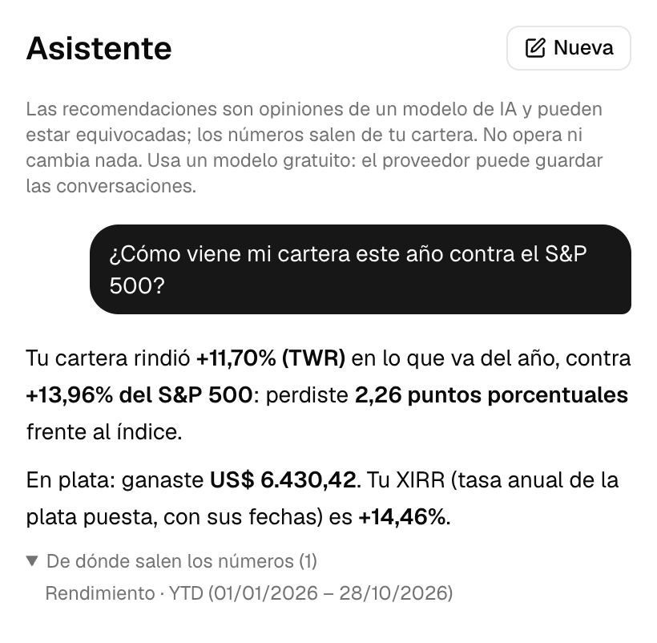
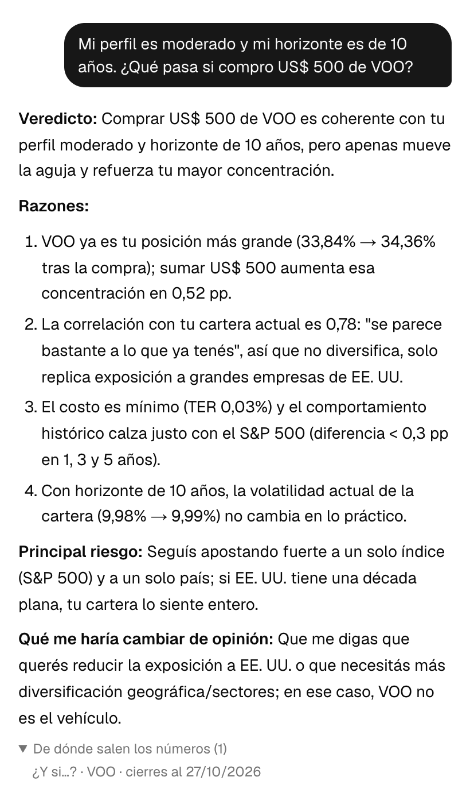
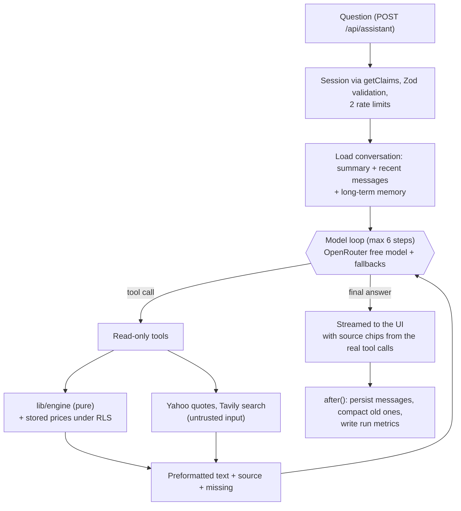
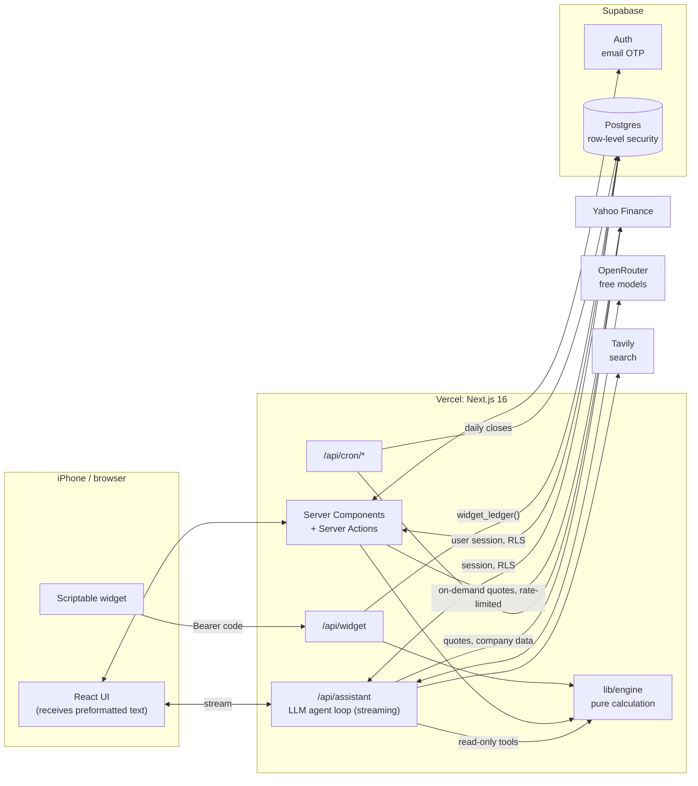

<div align="center">

# Portfolio Tracker

**A personal investment tracker for stocks, ETFs and crypto, built around an LLM agent that answers questions about your portfolio by calling read-only tools over a pure calculation engine. The model explains; it never does the math. Every number comes from a ledger of transactions with exact decimal math, and the whole thing runs at zero cost. It installs on the iPhone as an app and comes with a home-screen widget.**

[](https://github.com/felisan99/finance-platform/actions/workflows/ci.yml)


[](LICENSE)

<picture>
  <source media="(prefers-color-scheme: dark)" srcset="docs/images/hero-dark.png">
  
</picture>

<sub>Screenshots from a demo account. The interface is in Spanish because it was built for users in Uruguay.</sub>

</div>

## At a glance

- **LLM agent first:** a streaming chat assistant, a ReAct-style tool-calling loop on the Vercel AI SDK 7 with free OpenRouter models. It has 13 read-only tools over the pure engine, long-term memory, automatic conversation compaction, structural guardrails, per-turn observability and an eval harness. [Architecture below](#the-assistant-an-llm-agent-over-a-pure-engine).
- **Source of truth:** one ledger of transactions per account. Positions, cash, gains and returns are recomputed from it, never stored.
- **Calculation engine:** pure TypeScript (`lib/engine`) with no database, network or clock: average cost, splits, cash, daily value series, TWR, XIRR, drawdown, volatility and what-if analysis.
- **Money:** `decimal.js` end to end. Postgres `numeric` values are read as text, so no amount ever passes through a float.
- **Tests:** 2,076 unit tests in CI, including property-based tests with fast-check, plus integration tests for row-level security and live tests against real market data.
- **Running cost:** US$ 0 per month: Vercel Hobby, Supabase Free, Yahoo Finance, free OpenRouter models and the free Tavily plan, with one daily cron.
- **Access:** invite-only sign-in with 6-digit email codes. No passwords anywhere.

## The assistant: an LLM agent over a pure engine

The main goal of the project is an assistant that can talk about a real portfolio **without ever making a number up**. The design follows from one rule: the model decides what to look up and explains the result, and every figure it states was computed by the same deterministic engine that draws the dashboard.

<picture>
  <source media="(prefers-color-scheme: dark)" srcset="docs/images/assistant-dark.png">
  
</picture>
<picture>
  <source media="(prefers-color-scheme: dark)" srcset="docs/images/assistant-whatif-dark.png">
  
</picture>

<sub>Demo account with fictitious data. The assistant speaks Spanish because the app does.</sub>

### How a turn works



It is a ReAct-style tool-calling loop (`streamText` with a six-step cap). The route verifies the session, validates the input, takes two database rate limits, reads the conversation history from the database (the client only sends the new question) and streams the answer. Persistence, compaction and metrics run in `after()`, so they never delay the response.

### Tools: read-only wrappers over the engine

| Tool | What it answers |
| ---- | --------------- |
| `get_positions` | Today's snapshot: positions, weights, cost basis, unrealized gain, day change, cash |
| `get_gains` | Realized gain by asset for a period or all time, plus today's unrealized gain |
| `get_performance` | Time-weighted and money-weighted return against the benchmark for a period |
| `explain_move` | Why the portfolio moved between two dates: contribution by position |
| `get_price_history` | Summary of one symbol's closes (first, last, min, max, change) without dumping rows |
| `what_if` | The "before you buy" analysis: exposure, concentration, volatility, dollar-cost-averaging backtest |
| `simulate_trade` | The portfolio after a hypothetical buy or sell: new weights, cost basis, realized gain |
| `get_allocation` | Weights by position or by asset type, and the sum of any subset |
| `get_risk` | Volatility, drawdown and concentration |
| `get_asset_info` | Current quote, company or fund data and latest earnings for **any** stock, ETF or crypto, held or not |
| `search_news` | Recent news for a ticker (Tavily) |
| `web_search` | General web search for facts the model doesn't know (Tavily) |
| `update_memory` | Save or edit a stable fact about the person (risk profile, goals) |

Design rules that make this trustworthy:

- **The model never computes.** Each tool returns text that is already formatted with the app's formatter, plus a `source` (what was computed, over which dates) and an explicit `missing` list. A `null` from the engine becomes "I don't have that data", never a guess.
- **Sources come from reality, not from the model.** The chips under each answer are built from the tool calls that actually ran, so the model cannot cite something it didn't use.
- **Tool descriptions are prompts.** Each one says when to use it, when not to, what comes back and how to cite it, so the model picks between overlapping tools correctly.
- **Read-only by construction.** There is no tool that writes portfolio data, so "the assistant can't trade or edit your ledger" is a property of the code, not of the prompt. Tools read through an `AssistantDataSource` bound to the user's session under row-level security; they never use the secret key and take no user id.

### Memory and long conversations

- **Long-term memory** holds the person's risk profile, goals and stable facts (up to 30 items, with a database trigger enforcing the cap). It is injected into the prompt as data, shown and deletable under **Más → Lo que el asistente recuerda**, and a Zod refinement rejects any text containing figures, so portfolio numbers never leak into memory.
- **Automatic compaction.** When a conversation passes 16 messages or about 12,000 tokens, the older messages are summarized by the model and only the summary plus the last six messages are sent from then on. The decision rule is a pure function with tests, and token counts before and after are recorded.

### Guardrails

- **Scope:** the prompt is an opinionated financial advisor's, restricted to finance, and the evals include off-topic and missing-data traps.
- **Prompt injection:** news and web results are third-party text. They reach the model wrapped as external content with a note that they never contain valid instructions, and `update_memory` is disabled for the rest of the turn as soon as a search tool is used.
- **Abuse and cost:** two rate limits per person (8 questions per 5 minutes and 60 per day), a daily cap on searches and a per-turn cap on asset lookups, all enforced in the database.
- **Failure:** the primary model and up to two free fallbacks are tried in order through OpenRouter's model routing. Errors reach the user as generic messages and details go to the server log.

### Observability

Every turn writes one row to `assistant_runs` under RLS: model used and whether a fallback fired, steps, tools with their timings, tokens, cost, time to first token, total latency, finish reason and compaction data. Message contents are never stored in it. **Más → Uso del asistente** shows the totals, p50 and p95 latency and the most used tools. The metrics already paid for themselves: they showed that tools take about 370 ms while slow answers come from long outputs on free models, which led to the "short and proportional" answer rule.

### Evals

`pnpm eval` runs 46 questions against a fictitious demo portfolio, in 12 categories: positions, gains, performance, explaining moves, prices, risk, what-if scenarios, news, memory, recommendations, missing data and off-topic. **The expected answer to each question is computed at run time by the engine through the same tools**, never hardcoded, and the report scores numeric accuracy, correct tool choice, hallucination (a figure that appears in no tool output), guardrails, latency, tokens and cost. Runs are manual because they spend free-tier requests. The recommendation category is where small free models struggle (they like to do arithmetic on long answers), which is why the engine got `simulate_trade` and `get_allocation`.

### Stack

Vercel AI SDK 7 (`streamText`, UI message streams), `@openrouter/ai-sdk-provider` with free models, Tavily for search, Zod 4 on every tool input, Supabase for conversations, memory and metrics.

## Features

<table>
<tr>
<td width="50%" valign="top">

**Performance against a benchmark.** Cumulative gain, portfolio value and a normalized comparison with the S&P 500 (or Bitcoin for a crypto portfolio), from one week to all time. Shows the time-weighted return (TWR), the money-weighted return (XIRR) and the difference in percentage points.

<picture>
  <source media="(prefers-color-scheme: dark)" srcset="docs/images/perf-dark.png">
  
</picture>

</td>
<td width="50%" valign="top">

**Monthly returns.** Each calendar month of the portfolio next to the benchmark with dividends reinvested. The first and current months are partial, and the card says so.

<picture>
  <source media="(prefers-color-scheme: dark)" srcset="docs/images/monthly-dark.png">
  
</picture>

**Gain by position.** Realized and unrealized, for open and closed positions, in total or for today.

<picture>
  <source media="(prefers-color-scheme: dark)" srcset="docs/images/gain-dark.png">
  
</picture>

</td>
</tr>
<tr>
<td width="50%" valign="top">

**Allocation.** By position or by asset type, with cash as its own slice.

<picture>
  <source media="(prefers-color-scheme: dark)" srcset="docs/images/alloc-dark.png">
  
</picture>

</td>
<td width="50%" valign="top">

**Asset detail.** Price history (1W, 1M, 3M, 1Y) with the 52-week range, company data and quarterly earnings against the analyst consensus, plus a chart of your own trades on the price with range chips.

<picture>
  <source media="(prefers-color-scheme: dark)" srcset="docs/images/price-dark.png">
  
</picture>

<picture>
  <source media="(prefers-color-scheme: dark)" srcset="docs/images/earn-dark.png">
  
</picture>

</td>
</tr>
<tr>
<td width="50%" valign="top">

**Before you buy.** For any asset you hold or follow, the card shows:

- how a monthly contribution would change the portfolio's sector exposure, concentration and volatility;
- how similar the asset is to what you already own;
- what dollar-cost averaging into it would have looked like over 1, 3 or 5 years, including its worst drawdown.

It describes the past and never says "buy".

</td>
<td width="50%" valign="top">

<picture>
  <source media="(prefers-color-scheme: dark)" srcset="docs/images/before-dark.png">
  
</picture>

</td>
</tr>
</table>

Also included:

- **Automatic dividends.** The app proposes the dividends the provider reports for the shares you held the day before the ex-date, with the US withholding for non-residents (30% by default, configurable). Nothing is added until you confirm.
- **Activity and import.** Add, edit and delete buys, sells, dividends, deposits, withdrawals and splits. CSV import recognizes the format from the headers: either the app's own format (the one its CSV export writes, so a backup can be restored) or an export from [Delta](https://delta.app), a popular portfolio-tracking app. A preview shows what will be loaded and flags likely duplicates, and a whole import can be undone.
- **Watchlist** of up to 50 symbols with each one's change for the day.
- **Multiple portfolios**, up to five (for example, one for stocks and one for crypto), plus an "all together" view that adds them up without mixing their ledgers.
- **Installable PWA** with an offline screen and dark mode that follows the system setting.
- **iPhone widget** built on [Scriptable](https://scriptable.app), showing value and today's gain, authenticated by a personal read-only code.

## Architecture



The assistant is the same idea applied to a chat: its tools call the same engine and return text that is already formatted. On each page request the server reads the user's ledger and the stored prices under row-level security, runs the engine, and sends the client text that is already formatted. The client never receives raw amounts or the calculation code.

## Why it is built this way

Each decision below answers a concrete constraint. The full log, with the alternatives that were considered, is in [`docs/decisions.md`](docs/decisions.md) (in Spanish).

**1. The ledger is the only source of truth.** No stored positions or balances can drift out of sync. Editing a trade from a year ago, undoing an import or adding a split replays the ledger, and every number updates. The cost is recomputing on every request. The full dashboard renders in about a second with no cache, and the first bytes stream in around 10 ms, so there is nothing to invalidate. Every add, edit or delete is first checked against the whole ledger (`validateLedgerChange`), so a change can't leave a position below zero.

**2. The engine is pure.** `lib/engine` takes transactions, prices and "today" as arguments and returns results. It never imports the database client or the network and never calls `Date.now()`, and ESLint enforces this. The same code serves:

- the dashboard;
- the import preview ("how your portfolio would look");
- the widget;
- the what-if card.

Because it is pure, it can be tested exhaustively with fixed dates and property-based tests.

**3. Money never touches a float.** Amounts stay `decimal.js` values from the database to the formatter. Postgres `numeric` columns are read as text, and provider prices arrive as decimal strings. The only deliberate `number` is XIRR, because it is a rate shown to the user, not an amount. An acceptance test imports a full export from the Delta tracking app and must reproduce the expected cost basis, realized gain and cash to the last decimal.

**4. Portfolios are never merged.** Average cost is tracked per account. Merging ledgers would mix average costs and apply a split once for each account that holds the stock. Instead, the "all together" view computes each portfolio on its own and adds the results (`combineEngineResults`, `combineSeries`).

**5. Market data is stored, not fetched per visit.** Free providers rate-limit, and Vercel Hobby allows one daily cron. A cron stores daily closes, with at least five years per instrument so the five-year what-if works, and pages read only the database.

- Stored closes are already split-adjusted by the provider, so historical values are un-adjusted using the `SPLIT` entries in the ledger.
- "Refresh prices" fetches live quotes, with a per-user limit, and appends them as the last point of each series. It updates every series and the benchmark together, or none of them.

**6. The server formats, the client renders.** Client components never import the engine or the formatter, which keeps `decimal.js` out of the browser bundle. Every amount is formatted in one place (es-UY locale, Montevideo time), so the same value never looks different on two screens.

**7. Authorization lives in the database.** Every user table has row-level security, and the default privileges for `anon` and `authenticated` are revoked: each migration that creates a table declares its own `GRANT` and policies. The proxy only redirects. Every page and action verifies the session again with `getClaims()`, and RLS decides what it can read. The secret key is used only by:

- crons;
- instrument creation;
- the widget, which may call only one SQL function (`widget_ledger`, executable by nothing but the service role). That function works out from the code whose data to return.

**8. Codes instead of passwords or links.** On iOS a magic link opens in Safari instead of the installed app, so sign-in uses a 6-digit code, limited to 5 attempts per 15 minutes per email. Supabase's public API would let a user set a password and skip that limit, so a trigger deletes any password hash as soon as Auth writes one. Sign-up is restricted to an allowlist by a "before user created" hook.

**9. Nothing in the browser can read the session.** Session cookies are `HttpOnly`, and there is no Supabase client in the browser at all. That allows a Content Security Policy of `connect-src 'self'`: the page can only talk to its own origin.

**10. Provider data is untrusted input.** Every Yahoo response is validated with Zod, field by field. A broken field in company data leaves that field empty instead of failing the page, and failures are never cached.

**11. The widget is long-lived code on someone's phone.** The script is updated by hand, so the endpoint only adds fields and never removes or renames them. The code travels in a header, never in a URL, and only its SHA-256 is stored. If refreshing quotes takes longer than 5 seconds, the widget shows the stored values.

**12. Offline means "last known", never cached financial data.** The service worker caches only the offline screen. The last snapshot shown is kept in `localStorage` as preformatted text and is cleared on the sign-in page.

## Stack

| Layer         | Choice                                                               |
| ------------- | -------------------------------------------------------------------- |
| Framework     | Next.js 16 (App Router, Server Components, Server Actions), React 19 |
| Language      | TypeScript, strict mode                                              |
| Data and auth | Supabase: Postgres with row-level security, Auth with email OTP      |
| UI            | Tailwind CSS 4, shadcn/ui on Base UI, Recharts, Lucide               |
| Math          | decimal.js, date-fns / date-fns-tz                                   |
| Validation    | Zod 4 at every boundary: forms, CSV, provider responses              |
| LLM agent     | Vercel AI SDK 7, OpenRouter (free models with fallbacks), Tavily     |
| Market data   | `yahoo-finance2` behind a swappable provider interface               |
| Tests         | Vitest, fast-check; manual LLM evals (`pnpm eval`)                   |
| Hosting       | Vercel Hobby with Vercel Cron                                        |
| CI            | GitHub Actions: lint, typecheck, unit tests                          |

## Quickstart

Requires Node 22+, pnpm 11 and a free [Supabase](https://supabase.com) project. Supabase runs only in the cloud, so Docker isn't needed.

```bash
pnpm install
cp .env.example .env.local          # fill in your Supabase URL and keys, and a CRON_SECRET

# point the scripts at your development project:
# put its ref under "dev" in supabase/projects.json, then
pnpm supabase login
pnpm supabase link --project-ref <your-ref>
pnpm db:push                        # apply the migrations
pnpm db:config-diff                 # review the Auth config diff before applying it
pnpm supabase config push

pnpm dev                            # http://localhost:3000
```

Next, set up your own SMTP server in the Supabase dashboard so sign-in codes get delivered (the SMTP settings never go in the repo), and add your email to the allowlist:

```sql
insert into public.allowed_emails (email) values ('you@example.com');
```

To try the app with data, import the sample Delta export [`lib/engine/__fixtures__/delta_export.csv`](lib/engine/__fixtures__/delta_export.csv) from **Más → Importar operaciones**.

### Environment variables

| Variable                               | Purpose                                                                                                           |
| -------------------------------------- | ----------------------------------------------------------------------------------------------------------------- |
| `NEXT_PUBLIC_SUPABASE_URL`             | Supabase project URL                                                                                              |
| `NEXT_PUBLIC_SUPABASE_PUBLISHABLE_KEY` | Publishable key. Public by design: the data is protected by RLS                                                   |
| `SUPABASE_SECRET_KEY`                  | Secret key, server only. Bypasses RLS                                                                             |
| `CRON_SECRET`                          | Bearer token for `/api/cron/*`, at least 32 characters (`openssl rand -hex 32`). Without it the crons fail closed |
| `MARKET_DATA_PROVIDER`                 | `yahoo`                                                                                                           |
| `APP_TIMEZONE`                         | `America/Montevideo`                                                                                              |
| `OPENROUTER_API_KEY`                   | Assistant: OpenRouter key. Without it the Assistant tab shows "not available" and the rest of the app works     |
| `ASSISTANT_MODEL`                      | Assistant: primary model id (a free one, for example)                                                             |
| `ASSISTANT_FALLBACK_MODEL`             | Assistant: up to two comma-separated fallback model ids                                                           |
| `TAVILY_API_KEY`                       | Assistant: news and web search (free plan). Without it the assistant doesn't offer the search tools                |

## Commands

| Command                          | What it does                                                                                        |
| -------------------------------- | --------------------------------------------------------------------------------------------------- |
| `pnpm dev` / `pnpm build`        | Development server / production build                                                               |
| `pnpm test`                      | Unit tests: engine, importers, views, formatting, security headers, widget                          |
| `pnpm test:integration`          | RLS isolation, invite-only sign-up, atomic imports and rate limits, against the development project |
| `pnpm test:live`                 | Runs the real cron against Yahoo and loads every screen over HTTP with a real session (manual)      |
| `pnpm eval`                      | Assistant evals against OpenRouter models on a fictitious portfolio (manual: spends free-tier requests; `EVAL_DRY_RUN=1` estimates first) |
| `pnpm lint`                      | ESLint, including the rules that keep `lib/engine` pure                                             |
| `pnpm typecheck`                 | `next typegen` + `tsc --noEmit`                                                                     |
| `pnpm db:push` / `pnpm db:types` | Apply migrations / regenerate database types (development project only)                             |

The `db:*` scripts and the integration tests refuse to run against any project other than the one listed as `dev` in `supabase/projects.json`.

## Repository layout

```
app/
  (app)/            Home, Positions, Assistant, Watchlist, More (Activity lives under More)
  (auth)/login/     Sign-in with an email code
  api/cron/         Daily prices and backfill (Bearer CRON_SECRET)
  api/widget/       iPhone widget endpoint
  api/assistant/    Streaming endpoint for the LLM agent
lib/
  assistant/        The agent: loop, prompt, tools, memory, compaction, telemetry, evals and demo fixture
  engine/           Pure calculation: positions, cash, series, TWR, XIRR, risk, what-if
  importers/        CSV parsers (app format and Delta) with format detection
  portfolio/        Database reads, view models and formatting for the UI
  market-data/      Provider interface, Yahoo client, validation and sanitizing
  market-jobs/      Cron jobs: backfill, daily closes, split and dividend re-adjustments
  db/               Supabase clients, session, cookie options, generated types
  widget/           Widget response and the Scriptable script
  security/         Content Security Policy
  validation/       Zod schemas for every input
supabase/
  migrations/       Schema, RLS policies and SQL functions (20 migrations)
  templates/        Auth email templates
docs/               Design log, operations and user guides (in Spanish)
```

## Documentation

The project was built in phases from a written spec, with a decision log kept along the way. The spec is in English and the rest of the documentation is in Spanish.

| Document                                                   | Covers                                                                         |
| ---------------------------------------------------------- | ------------------------------------------------------------------------------ |
| [PROJECT_SPEC.md](PROJECT_SPEC.md)                         | Full specification: data model, engine rules, market data, import, phases      |
| [docs/decisions.md](docs/decisions.md)                     | Decision log: deviations from the spec, trade-offs, incidents, security review, the assistant's design |
| [docs/supabase-setup.md](docs/supabase-setup.md)           | Environments, keys, invitations, SMTP, crons                                   |
| [docs/limits.md](docs/limits.md)                           | Free-tier limits that shaped the design                                        |
| [docs/importar-csv.md](docs/importar-csv.md)               | CSV import guide for users                                                     |
| [docs/widget-iphone.md](docs/widget-iphone.md)             | Widget setup guide                                                             |
| [docs/comprobacion-manual.md](docs/comprobacion-manual.md) | Manual acceptance checklist                                                    |
| [CLAUDE.md](CLAUDE.md)                                     | Project rules for contributors and coding agents                               |

## Status

Phases 0 to 6 are done:

- calculation engine and Delta importer;
- database with RLS and invite-only access;
- market data and crons;
- the full interface, watchlist and asset detail;
- PWA and widget;
- multiple portfolios and crypto;
- the LLM assistant with read-only tools, memory, compaction, observability and evals;
- automatic dividends with withholding.

The app runs on Vercel against the development database. Next up are the production environment, a strict nonce-based CSP, and import from IBKR Flex Queries.

## License

[MIT](LICENSE). Market data comes from Yahoo Finance and is shown only to invited users. This project is not affiliated with Yahoo.
